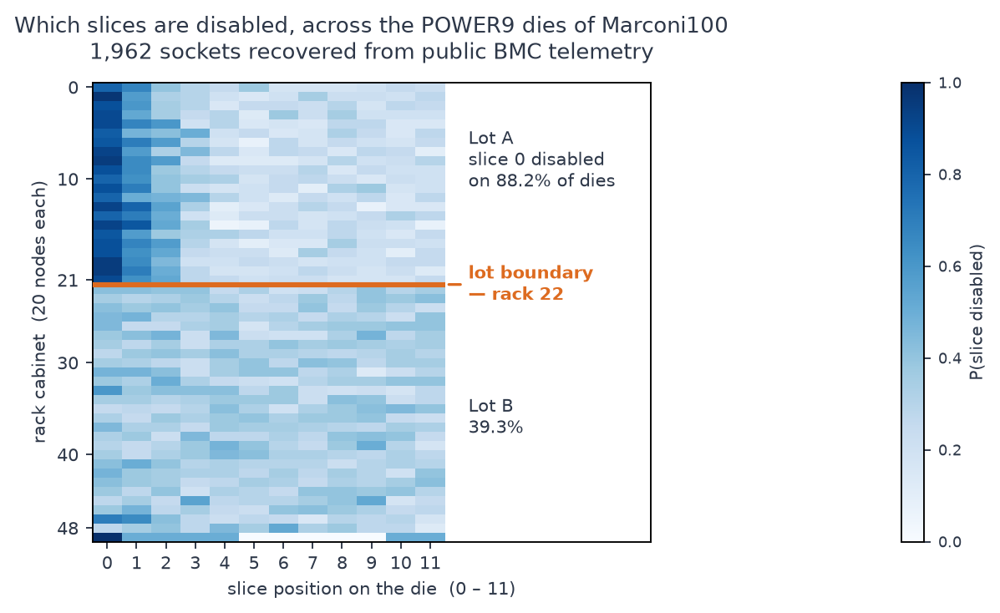

# m100-silicon-binning — recovering per-die CPU core-harvest maps from BMC telemetry

[](https://github.com/MSKazemi/m100-silicon-binning/actions/workflows/reproduce.yml)
[](LICENSE)
[](https://doi.org/10.1038/s41597-023-02174-3)
[](https://mskazemi.com/m100-silicon-binning/)



**Processor vendors sell large dies as lower-core-count parts by disabling cores — defective or
not — and do not publish which: you are told the part has 16 cores, not *which* 16. This
repository shows that the out-of-band telemetry supercomputers already collect gives it away, and
recovers the map for 1,962 POWER9 sockets of CINECA's Marconi100.**

The mechanism is simple: a baseboard management controller exposes one thermal sensor per core
position on the die and does **not** renumber the survivors compactly. So the `pX_coreY_temp`
metrics that never report mark exactly the disabled positions — the die's harvest map — published
inadvertently, at fleet scale, in a public dataset. An owner can read the same thing off a single
POWER9 machine ([Smith, 2020](https://www.flamingspork.com/blog/2020/03/22/my-power9-cpu-core-layout/));
what is new here is recovering it for a whole fleet from published data and following the maps
over time.

- **What this is** — an open-source analysis pipeline and the reproducible results of applying it.
- **Who it is for** — HPC operators, systems and reliability researchers, semiconductor-yield
  researchers, and anyone who publishes or consumes fleet telemetry datasets.
- **Why you might care** — you can detect latent hardware cohorts without vendor cooperation, infer
  processor replacements and moves with no asset database, spot field core-guard events, and check
  whether your own published telemetry carries the same disclosure.
- **How to start** — [Reproducing](#reproducing) runs the headline results in minutes from the
  derived tables committed here.

> **Not to be confused with** the architectural sense of "core harvesting" — reclaiming *idle CPU
> cycles* for co-located work. That is unrelated. This is about *silicon*: which physical cores
> are disabled on each die.

> **Status: unpublished preprint.** The manuscript is [`paper/paper.tex`](paper/paper.tex)
> (builds to `paper/paper.pdf`). Read [`LIMITATIONS.md`](LIMITATIONS.md) before relying on any
> result.

## What we found

Across **1,962 sockets** with a well-defined map (981 nodes), over the full 31-month record
(2020-03 to 2022-09, 1.67 M socket-days):

| Finding | Evidence |
|---|---|
| Every socket reports exactly 16 of 24 cores | 99.9847% of 1.67 M socket-days; no fully-sampled socket-day reports more than 16 |
| Every map disables whole slices `(2k, 2k+1)` | 1,962 / 1,962 maps, no exception on 1.52 M clean socket-days, although POWER9 can disable single cores |
| The map is per-die, not per-SKU | 443 of 495 possible patterns observed |
| Harvested slices cluster, above all within POWER9 quads | mean index gap z = −20.7 against 100,000 exchangeable curveball draws; 20 of 66 pairs family-wise significant; 8 of the 9 positive excesses at \|Δk\| ≤ 2, six of them the two slices of one quad, which IBM's chip diagram places side by side |
| Thermal coupling follows the quad, not the slice | at index distance 1 over 1,948 sockets, cores of one quad couple at r = +0.48 (other slice) and +0.37 (same slice), index neighbours in different quads at +0.10; 49 racks resampled |
| The sensor index is IBM's core numbering | IBM's chip diagram places the quads in two bands of three, each quad's cores stacked; thermal coupling confirms the quads, but beyond them follows how the surviving cores are numbered, so the layout rests on IBM's documentation |
| Two rack-aligned lots, boundary at rack 22 | permutation-calibrated p = 2.5e-4 (no null draw of 4,000 reaches it); rack 22 in ≥ 98.7% of rack-level bootstrap draws; 47/49 held-out racks (95.9%) placed in the right lot, boundary re-found without them |
| Maps are stable over time | 96.8% of 839 k held-out socket-days predicted from a map measured a year earlier |
| Configuration changes coincide with **reboots**, measured | 126/132 transitions carry a flagged `boottime` change, against 47.6% expected from length-matched controls (49.0 ± 4.6 of 103 node-level transitions); dated by boot epoch, 133 of 136 contain a boot and none is seen without one |
| Field core-guard episodes, confirmed by the OS | nine in steady state, each matched by the OS's own CPU count, whose window brackets the sensor one, and beginning at a boot; three meet the strict one-slice criterion |
| Die changes and new processors, with no asset database | sockets change die at 2.1% per socket-year (rack-clustered 95% CI [1.6, 2.7]); 50 of the 96 changes are dies moved from another socket, so new processors enter at an inferred 1.0–1.2% |
| The map does **not** usefully predict replacement | held-out risk-set concordance 0.55, 95% CI [0.48, 0.61] (permutation null 0.50 ± 0.04, p = 0.12) |
| Its association with socket power is bounded to a few watts | +2.7, −1.5, −1.0 W over each map summary's full range, 90% CIs within ±5.6 W (±7.4 W in every sensitivity design), against a ±5 W margin |
| The disclosure is nearly free to exploit | a single 20 s interval recovers the exact map in 99.95% of socket-intervals (measured on raw timestamps); neither coarser cadence nor random deletion is a mitigation |

The thermal rows above revise earlier versions of this table. A three-day sample once reported the
sensor-index ordering as "not established" and the within/cross-slice contrast as +0.51 vs +0.29;
the full census reversed the first and cut the second threefold, and the socket-level reanalysis
of 2026-09 showed that the contrast mixes two kinds of neighbour and changes sign between months,
and that the die layout comes from IBM's documentation rather than from telemetry. These and the
other corrections, several of them prompted by an external review in 2026-09, are documented
rather than quietly fixed; see [`CHANGELOG.md`](CHANGELOG.md) and [`LIMITATIONS.md`](LIMITATIONS.md).

## Known limitations

Read these before relying on any result. The full register, with what would settle each item, is
[`LIMITATIONS.md`](LIMITATIONS.md).

- **Single system** (OI-10). Every number comes from one machine, Marconi100. Whether the lot
  structure or the clustering generalises to other POWER9 installations, or to other vendors, is
  untested. This is the largest remaining weakness.
- **The lot boundary has no external confirmation** (OI-9). The changepoint at rack 22 is
  statistically sharp, but no procurement or delivery record was available to check it against.
  "Procurement lot" remains the most parsimonious explanation, not a documented fact. The room and
  any setting that stays with the rack are ruled out by direct tests; delivery, vendor-side
  provisioning and installation-time setup are not separable from telemetry.
- **Why a position is disabled is not identified** (OI-3, OI-18). Telemetry shows which positions
  are disabled, not whether for a defect or for product segmentation. A correlated defect process
  and a binning *policy* that disables contiguous blocks both predict the clustering we measure,
  and the fitted model cannot attribute it. That model is also demonstrably incomplete.
- **Map-change classes are inferred** (OI-19). RELABEL / CPU-SWAP / NODE-SWAP name the event a map
  change is consistent with; no service record confirms them.
- **The map's association with power is bounded and small, but not provably negligible** (OI-13).
  An earlier version called it "operationally invisible"; that was withdrawn, and a later +7.9 W
  came from fitting three collinear map summaries jointly.
- **The p0/p1 socket labels occasionally swap** (OI-8) between collection periods.
- **Thermal inference is socket-level now** (OI-11). Per-socket matrices and cell support counts
  are published (`analysis/thermal_socket_*`), and every thermal interval resamples the 49 racks.

## Does this apply to my fleet?

The method needs one thing: a management controller that exposes **one sensor per core position**
and does not renumber survivors. Check by looking at whether every node reports the same compact
set of core indices.

- If every socket reports cores `0..15`, your BMC renumbers — the channel is closed, nothing to
  recover.
- If sockets report *arbitrary* 16-element subsets of `0..23`, the channel is open and the method
  applies directly.

For a fleet with 24-core dies selling as 16-core parts, that is 495 possible patterns; we observed
443 of them. See [`docs/faq.md`](docs/faq.md).

## Reproducing

Every number in the tables above is reproducible from data committed here — no 49.9 TB download
required. Set up once:

```bash
python3 -m venv .venv
.venv/bin/pip install -r requirements-lock.txt   # the exact environment of the results (Python 3.12)
# or: .venv/bin/pip install -r requirements.txt  # version floors, for development
.venv/bin/pip install -r requirements-dev.txt    # adds pytest
.venv/bin/python -m pytest -q tests/             # about 20 s
```

**Two derived populations, and it matters which you run.** `analysis/counts_*.parquet` (117 KB) is
a *single-month snapshot*; `daily/` (16 MB, 31 files) is the *full 31-month record* the paper
reports. They differ slightly, and the paper says why: the snapshot is representative, but not
identical. [`DATA.md`](DATA.md) documents every derived table and [`DATA.sha256`](DATA.sha256)
checksums them.

Single-month snapshot — fast, and shows the mechanical finding:

```bash
.venv/bin/python analysis/binning_stats.py
```

```
sockets with exactly 4 disabled pairs: 1960
possible patterns C(12,4) = 495
observed distinct patterns: 442
  pair  0 (cores  0, 1):  61.7%   ##############################
  chi2 uniformity = 836.5 (df=11, crit_0.001=31.3) -> NON-uniform
mean index-gap between disabled pairs: observed 4.243, null 4.589 +/- 0.017  -> z = -20.11
```

Full record — the lot boundary, calibrated against a permutation null:

```bash
.venv/bin/python analysis/changepoint.py
```

```
sockets 1,960   racks 49   candidate boundaries 3..46 (44 of 48, trimmed at 100 sockets per side)
  observed argmax boundary : rack 22   |t| = 26.6
  rack-permutation null    : max|t| = 7.08 +/- 2.41, 99th pct 14.41, max seen 17.95
  calibrated p             : 2.50e-04  ((b+1)/(B+1); 0/4000 null draws reach the observed max)
  breakpoint rack = 22   sockets resampled within rack: rack 22 in 100.0% of 2000 (2.5-97.5 pct [22, 22])
  fits that split the remaining racks exactly as the full-data boundary does: 49/49
  rack-level accuracy   : 95.9%  (47/49 racks)
```

Other entry points, all running off committed tables:

| Script | Reproduces |
|---|---|
| `analysis/reboot_evidence.py` | 126/132 transitions coincide with a real `boottime` change; epoch-dated 133/136; node-stratified exact test |
| `analysis/lifecycle_os_crosscheck.py` | every OS departure from 128 logical CPUs matched by a BMC core loss (9 of 9); census of non-16 socket-days |
| `analysis/lifecycle_taxonomy_errors.py` | taxonomy error mechanisms, dies moved between sockets, clustered rate intervals |
| `analysis/survival.py` | the reliability null (risk-set concordance 0.55, p = 0.12; about 4 min) |
| `analysis/survival_legacy_check.py` | re-derives the first release's 0.448 and shows it was a cross-validation artefact |
| `analysis/equivalence.py` | the TOST power analysis on contemporaneous maps, with placement and idle-day checks (about 1 min; 4,000 rack-clustered bootstraps) |
| `analysis/side_channel.py` | recovery cost, and which mitigations work (deletion models on the committed counts) |
| `analysis/side_channel_raw.py` | the same measured on the raw 20 s timestamps (needs one monthly tar) |
| `analysis/side_channel_values.py` | whether compact renumbering still leaks the map through the temperatures (needs one monthly tar) |
| `analysis/yield_model.py`, `gamma_clustered_se.py`, `model_quad.py` | the pairwise-interaction model, its rack-clustered uncertainty, and the quad split |
| `analysis/ppc.py` | parametric model-replicate checks of the clustering model |
| `analysis/curveball_null.py` | pair-level co-harvest tests against 100,000 exchangeable curveball draws (12–17 min on 10–12 cores) |
| `analysis/layout_hypotheses.py` | slice-layout scores incl. IBM's documented layout and the exact best of all 12!/2 orderings (set `THERM_MATRIX=thermal_corr_allnodes.npy`) |
| `analysis/thermal_socket_stats.py` | socket-level thermal inference: rack bootstrap, quad decomposition, strata |
| `analysis/thermal_ibm_layout.py` | thermal coupling against IBM's documented layout; physical versus logical-order tests |
| `analysis/thermal_column_test.py` | position-matched test inside each die column: IBM geometry versus core numbering |

**What the CI badge covers.** The [`reproduce`](.github/workflows/reproduce.yml) workflow runs the
test suite and re-derives the results above that need only committed tables, asserting their
values, on every push, pull request and monthly. It does **not** re-derive what needs the raw
archive (the per-socket thermal matrices, the raw-timestamp side-channel measurement, the SLURM
core placement), and it checks the committed output of the 100,000-draw curveball null rather than
rerunning it. [`docs/reproduce.md`](docs/reproduce.md) lists each step.

Only the raw thermal series are not committed — they are ~400 GB; their per-socket residual
matrices are (`analysis/thermal_socket_*`), so every thermal number re-derives without them. To
rebuild any derived table from scratch, download the M100 ExaData archives (twelve Zenodo records,
v1.0.0, one tar per month: [7588815](https://doi.org/10.5281/zenodo.7588815) for 2020, then
7589131, 7589320, 7589630, 7589942, 7590061, 7590308, 7590547, 7590555, 7590565, 7590574 and
7590583 for 2021-01 to 2022-09), then use `analysis/core_matrix.py`, `analysis/sweep_all_months.py`,
`analysis/sweep_covariates.py` or `analysis/thermal_socket_build.py`.

## Layout

```
paper/paper.tex                 the manuscript
LIMITATIONS.md                  open issues, with what would settle each
DATA.md, DATA.sha256            schema, lineage and checksums of the derived tables
requirements*.txt               floors (requirements.txt), exact environment (-lock), pytest (-dev)
tests/                          unit, regression and cross-surface consistency tests (pytest)
daily/ cov_all/ os_all/ power_all/ power/   derived per-(node, day) tables, one file per month
analysis/
  core_matrix.py                build (node, socket, core) sample counts from raw tars
  sweep_all_months.py           raw tars -> daily/ per-(node, socket, core, day) counts
  binning_stats.py              single-month marginals, chi-square, curveball null, co-disable z
  curveball_null.py             exchangeable curveball null, pair-level family-wise tests, mixing
  model_core.py                 pattern space, curveball samplers, pairwise model (tested)
  yield_model.py, ppc.py        pairwise-interaction fit; parametric model-replicate checks
  changepoint.py                permutation-calibrated max-t, held-out lot prediction
  cohort_boundary.py            rack-level boundary uncertainty and number of populations
  thermal_all_nodes.py          residual thermal correlation, fleet-wide (pooled; superseded below)
  thermal_socket_build.py       raw per-core series -> per-socket residual matrices (slow path)
  thermal_socket_stats.py       socket-level thermal inference from the committed per-socket files
  thermal_ibm_layout.py         thermal coupling against IBM's documented core layout
  thermal_column_test.py        die-column test: IBM geometry versus core numbering
  layout_hypotheses.py          scoring candidate slice layouts against thermal coupling
  sweep_covariates.py           one pass over the raw tars for boottime + workload covariates
  reboot_evidence.py            transitions against an independent boot signal
  lifecycle_os_crosscheck.py    OS logical-CPU departures against BMC core losses; non-16 census
  lifecycle_taxonomy_errors.py  taxonomy error mechanisms, die moves, clustered rates
  survival.py                   harvest map -> field replacement (a bounded null)
  survival_core.py              die tracking, grouped-time hazard, survival metrics
  equivalence.py                TOST on socket power: contemporaneous maps, placement + idle checks
  equivalence_core.py           its estimators
  equivalence_alloc.py          per-socket SLURM core placement from the job table (raw tars)
  side_channel.py               recovery cost, and which mitigations actually work
  side_channel_model.py         the deletion models behind it
  side_channel_raw.py           recovery measured on raw 20 s timestamps
  side_channel_values.py        does compact renumbering leak through the temperatures?
  make_*.py                     one script per paper figure (see docs/reproduce.md)
  *.json, *.npy, *.csv, *.parquet   derived tables and machine-readable results
```

## How this differs from adjacent work

- **PUF and hardware fingerprinting** answer *which die is this*, for traceability and counterfeit
  detection, using designed-in circuitry or physical access. We answer *what was disabled on it*,
  from telemetry alone. One harvest map is a partial identifier across the fleet (only 4.9% of
  sockets have one unique in it), though a node's two maps together are unique for 93% of nodes.
- **Disabled-unit surveys on other machines.** McCalpin recovered the disabled core pairs of every
  Xeon Phi in TACC's Stampede2 by running CPUID on each node, and its Xeons' disabled tiles from a
  privileged register; we read POWER9 maps from published out-of-band telemetry, with no access to
  the machines, and follow them daily for 31 months.
- **Manufacturing-variability studies in HPC** characterise the die by its *behaviour* — frequency
  and power spread under a cap, turbo variation. They treat the die as a black box; we recover
  which of its units are disabled.
- **Yield modelling** describes clustered killer defects directly, but is validated on fab data
  unavailable to system owners. We observe only which positions end up disabled, conditionally on
  the part's fixed count.
- **Node-level anomaly detection** establishes *that* nodes differ without recovering the hardware
  structure responsible.

## Contributing

The most useful contribution is not a code change. It is **a replication on another machine** —
the single largest open limitation is that every result comes from one system. Agreement or
disagreement both help; disagreement would delimit exactly when the technique works.

Also valuable: telling us a number is wrong (this project has corrected several of its own
results, most recently after an external review; see [`CHANGELOG.md`](CHANGELOG.md)), and pointing
at prior work we missed.

See [`CONTRIBUTING.md`](CONTRIBUTING.md) and the
[open issues](https://github.com/MSKazemi/m100-silicon-binning/issues) — several are labelled
`good first issue`.

## Citing

If you use this software or its findings, cite the manuscript. `CITATION.cff` is machine-readable
and GitHub renders a "Cite this repository" button from it. The manuscript is currently an
unpublished preprint — check back for the published reference.

## Data source

Borghesi, A., Di Santi, C., Molan, M., Ardebili, M.S., Mauri, A., Guarrasi, M., Galetti, D.,
Cestari, M., Barchi, F., Benini, L., Beneventi, F., Bartolini, A.
"M100 ExaData: a data collection campaign on the CINECA's Marconi100 Tier-0 supercomputer."
*Scientific Data* **10**, 288 (2023). https://doi.org/10.1038/s41597-023-02174-3

## License

Code is [MIT](LICENSE). The manuscript text and figures are CC BY 4.0, matching the licence of the
underlying M100 ExaData release.
